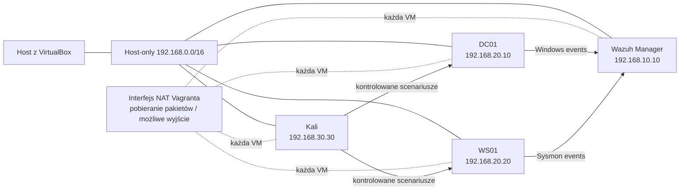

# 01 — Architektura laboratorium

Ten dokument opisuje topologię faktycznie skonfigurowaną w
[`infrastructure/vagrant/Vagrantfile`](../infrastructure/vagrant/Vagrantfile).
Adresy `.10`, `.20` i `.30` oznaczają role hostów, a nie osobne VLAN-y.

## Założenia

| Obszar | Konfiguracja |
|---|---|
| Cel | Ćwiczenie detekcji, triage i analizy incydentów na syntetycznych zdarzeniach |
| Hypervisor | Vagrant z VirtualBox; konfiguracja VMware wymaga osobnej weryfikacji |
| Goście | 4 maszyny: Wazuh, kontroler domeny, stacja Windows i Kali |
| Sieć ról | Jedna wspólna sieć host-only `192.168.0.0/16` |
| Dostęp do pakietów | Domyślny interfejs NAT Vagranta jest wykorzystywany podczas instalacji i może zapewniać gościom wyjście do internetu |
| Ograniczenie | Brak routera, zapory między rolami i izolacji L2/VLAN w sieci host-only |

## Topologia

Host-only pozwala hostowi i gościom komunikować się lokalnie. Nie filtruje ruchu
między Kali, Windows i Wazuhem. Interfejs NAT nie jest zaporą aplikacyjną i może
zapewniać ruch wychodzący. Używaj skryptów z `attacks/` wyłącznie w środowisku,
które kontrolujesz, i sprawdź routing hostów przed uruchomieniem scenariusza.

## Adresacja i usługi

| Host | IP host-only | Rola | Główne porty |
|---|---|---|---|
| `wazuh-srv` | `192.168.10.10` | Wazuh Manager, Indexer, Dashboard | 443, 1514/TCP, 1515/TCP, 55000 |
| `dc01` | `192.168.20.10` | Windows Server 2019, AD DS, DNS | DNS/AD; szczegóły zależą od profilu systemu |
| `ws01` | `192.168.20.20` | Windows 10, domenowa stacja robocza, Sysmon | RDP/SMB tylko jeśli włączone przez konfigurację gościa |
| `kali` | `192.168.30.30` | Kali Linux, narzędzia do kontrolowanych testów | zależne od uruchomionego scenariusza |

Windows używa adresów DNS kontrolera domeny `192.168.20.10`. Manager i hosty
Windows komunikują się przez wspólną sieć `/16`; nie istnieją tu osobne trasy
VLAN ani ograniczenia „Kali → Wazuh”. Dokładne reguły gości i ruch do hosta
zależą też od hypervisora oraz zapory systemowej.

## Przepływ telemetrii

1. Sysmon i dzienniki Windows tworzą zdarzenia na `dc01` i `ws01`.
2. Agent Wazuh przekazuje telemetrię do `wazuh-srv` na TCP/1514.
3. Dekodery i reguły Wazuha klasyfikują zdarzenie; własne reguły są w
   `detection-rules/custom-wazuh-rules.xml`.
4. Analityk przegląda alerty w Dashboardzie i dokumentuje triage.

Dokumenty w `docs/detections/` opisują założenia, mapowanie MITRE ATT&CK,
fałszywe alarmy i ograniczenia poszczególnych reguł. Walidacja XML i fixture
JSON nie zastępują testu prawdziwego Windows Event Channel, agenta i managera.

## Zasoby i ograniczenia

Vagrantfile przydziela 6 GiB Wazuhowi oraz po 3 GiB każdej z trzech pozostałych
maszyn. Zaplanuj co najmniej 32 GiB RAM hosta, miejsce na boxy/obrazy oraz
hypervisor z włączoną wirtualizacją sprzętową. Na słabszym komputerze uruchamiaj
maszyny etapami. Czas pierwszego uruchomienia zależy od pobierania boxów,
Windows Update i instalacji Wazuha; nie jest gwarantowane 25 minut.

To laboratorium edukacyjne: pojedynczy manager i indexer nie zapewniają HA,
retencji ani segmentacji sieci produkcyjnej. Szczegółowe polecenia instalacji
znajdują się w [02-installation.md](02-installation.md).
